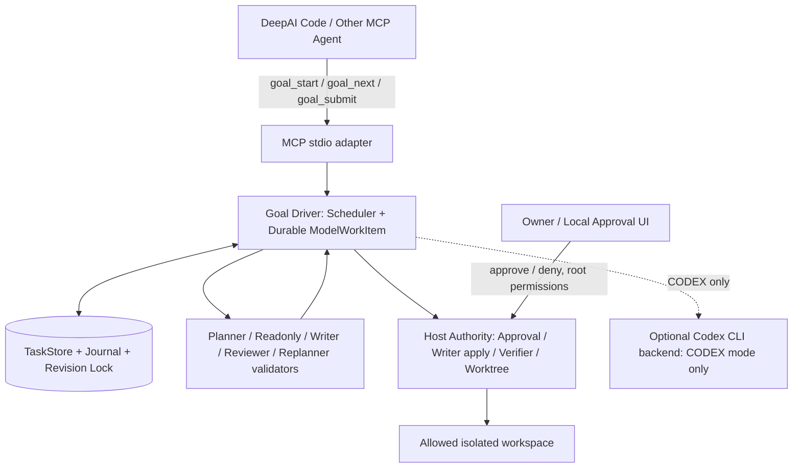
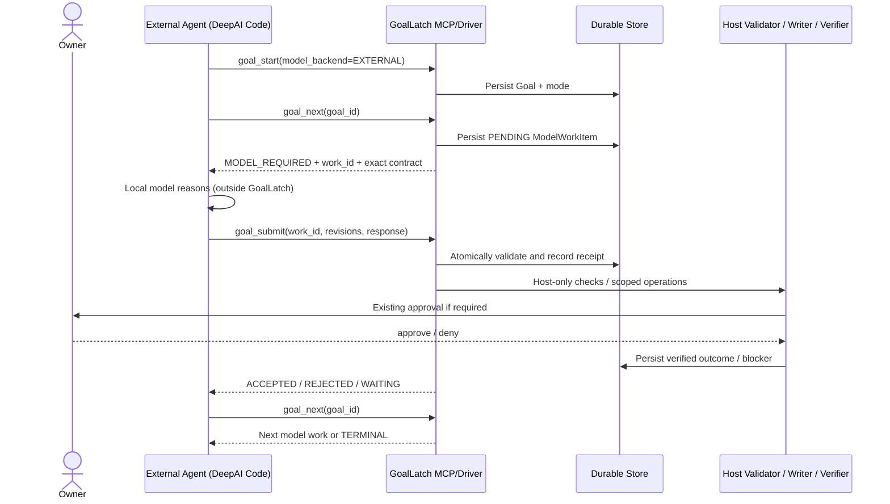

# GoalLatch External Agent Backend V1 — 基本アーキテクチャ設計

> **文書状態:** PROPOSED / 設計レビュー待ち（実装済み仕様ではない）  
> **作成日:** 2026-11-07（JST）  
> **対象リポジトリ:** [Yrika819/local-mcp](https://github.com/Yrika819/local-mcp)  
> **調査基準:** `main` = `e6950fdc3bab72982285888a81cce822743fbba5`  
> **提案ファイル配置:** `docs/EXTERNAL_AGENT_BACKEND_V1_ARCHITECTURE.md`  
> **想定読者:** Owner、GoalLatchの開発エージェント、レビュー担当者  
> **権威:** Ownerが承認するまでは**非規範的な提案**。既存 `SECURITY.md`、権限実装、保存形式の制約を上書きしない。

---

## 0. エグゼクティブ・デシジョン

**採用する中心原則:「推論は任意の外部エージェント、作業状態と変更権限はGoalLatch」。**

現在、DeepAI Code等のMCPクライアントがすでにLLMを利用していても、`goal_run`は内部で別のCodex CLIを起動する。これにより、独立したモデル呼び出し、反復プロンプト構築、モデル実行承認、および追加の利用枠消費が発生し得る。

V1では既存のCODEX実行方式を保存しつつ、**Codexを一度も起動しない `EXTERNAL` モード**を追加する。新規 `goal_next` と `goal_submit` を介して、ホストが発行したモデル作業をMCPクライアント側のAIが解決し、**検証・永続化・変更適用をGoalLatch側が完結する**。将来の `HYBRID` は別フェーズとする。

**V1の設計決定:**

| ID | 決定 | 根拠 |
|---|---|---|
| ADR-01 | `EXTERNAL`は明示的にopt-in。初期既定は従来の`CODEX` | 既存利用者の互換性 |
| ADR-02 | External Agentには **MCPのclient-driven tool loop** を採用 | クライアントのサポート範囲を広げる。旧MCP Samplingへの依存を回避 |
| ADR-03 | `ModelTransport::invoke`を非同期RPCへ無理に変換しない | 現行の同期契約・ロック・復旧保証を壊さない |
| ADR-04 | モデル作業はホストが発行した **durable ModelWorkItem** として記録 | クライアント切断・再送・再起動に耐える |
| ADR-05 | `goal_next`はホストによる状態進行と次の推論要求の取得、`goal_submit`は外部成果物の提出と検証 | 推論とホスト権限を分離 |
| ADR-06 | GoalStatusの公開既存enumをV1で破壊的変更しない | 永続データ/API互換性。モデル待ちは別軸で表示 |
| ADR-07 | `goal_submit`は**capability/permission grantではない** | モデル出力は非信頼データ |
| ADR-08 | EXTERNALモードのGoalLatch起因Codex CLI実行数は **必ず0** | 週制限節約の実装保証 |
| ADR-09 | 既存のWriter、Verifier、TaskStore、Approval、Managed Worktreeを再利用する | 安全境界の重複実装を避ける |
| ADR-10 | V1は同一Goalにつき未完了のModelWorkItemを最大1件 | レース・再送・監査を単純化。並列実行はV2以降 |
| ADR-11 | 既存の`goal_run`のCODEX動作は保持。EXTERNALではCodexを起動しない | 段階移行と事故防止 |
| ADR-12 | 運用上はBeta/実機検証までExperimental機能として提供 | Dogfoodingで既存オーケストレーションの停止問題が確認済み |

### 非目標

- Codex CLIや現在のモデル連携を直ちに削除すること。
- DeepAI Codeの内部モデルAPI、ユーザートークン、会話履歴をGoalLatchが取得すること。
- EXTERNALが外部エージェントの推論費用やトークン使用量まで0にすること。
- Windowsに存在しないUnix同等のsandbox保証を主張すること。
- Security V3の未実装部分、8時間Soak、MCP 2026-07-28への全面移行をこのPR群で一括完了すること。
- 自動Merge、Release、任意のネットワーク実行、承認の迂回。

## 1. 現行実装の確認済み基線

| 関連コード | 現状の意味 |
|---|---|
| [`src/agent.rs`](https://github.com/Yrika819/local-mcp/blob/e6950fdc3bab72982285888a81cce822743fbba5/src/agent.rs) | `ModelTransport::invoke()`は同期式。`ProductionModelTransport`からCodex CLIを呼ぶ。`MODEL_TIMEOUT=120s`、stdout 2MiB、prompt 256KiB |
| [`src/goal_backends.rs`](https://github.com/Yrika819/local-mcp/blob/e6950fdc3bab72982285888a81cce822743fbba5/src/goal_backends.rs) | Planner、Readonly、Writer、Reviewer、Replannerが共通の`GoalModelAgent`を利用 |
| [`src/mcp.rs`](https://github.com/Yrika819/local-mcp/blob/e6950fdc3bab72982285888a81cce822743fbba5/src/mcp.rs) | `goal_run`は`spawn_blocking`上のcurrent-thread runtimeでSchedulerを同期的に前進させる |
| [`src/goal_runner.rs`](https://github.com/Yrika819/local-mcp/blob/e6950fdc3bab72982285888a81cce822743fbba5/src/goal_runner.rs) | bounded `max_steps`で進行。**推論トークン予算とは異なる** |
| [`src/planner.rs`](https://github.com/Yrika819/local-mcp/blob/e6950fdc3bab72982285888a81cce822743fbba5/src/planner.rs) | ホスト所有の`CompletionCriterionId`とモデル提案内の`criterion_bindings`を厳格照合 |
| [`src/goal_api.rs`](https://github.com/Yrika819/local-mcp/blob/e6950fdc3bab72982285888a81cce822743fbba5/src/goal_api.rs) | `goal_result.result_state`は現在`TERMINAL`/`NOT_TERMINAL`のみ。`status`併読が必要 |
| [`src/task_store.rs`](https://github.com/Yrika819/local-mcp/blob/e6950fdc3bab72982285888a81cce822743fbba5/src/task_store.rs) | Goalのdurable state、セッションロック、Revision競合の境界 |
| [`src/writer.rs`](https://github.com/Yrika819/local-mcp/blob/e6950fdc3bab72982285888a81cce822743fbba5/src/writer.rs) / [`src/verifier.rs`](https://github.com/Yrika819/local-mcp/blob/e6950fdc3bab72982285888a81cce822743fbba5/src/verifier.rs) | 提案と権限付き適用・独立検証を分離 |
| [`docs/MCP_CLIENTS.md`](https://github.com/Yrika819/local-mcp/blob/e6950fdc3bab72982285888a81cce822743fbba5/docs/MCP_CLIENTS.md) | stdio MCP、`local-mcp start`のローカルセッションと明示`session_id`、Codexは`goal_run`に必要 |

**既知のDogfooding V1事実:** DeepAI CodeからMCP読取・編集・実行は動作。一方、完了条件ID参照エラー、`READONLY_BLOCKED → NO_ACTION`、Windowsの承認表示が観測されない問題が報告された。**根本原因を断定したものではない**。それぞれ独立の回帰テストと承認経路監査を要求する。

現状の`goal_start`は、利用者が`completion_criteria`を省略しても、objectiveからホスト所有の条件を1件生成する。このため「条件を追加した場合だけ失敗」した症状の説明にはPlanner出力とIDの比較が必要。

## 2. 全体構造と信頼境界



**信頼モデル:**

1. **Owner/ホスト**のみが許可ディレクトリ、実行許可、sandbox、write権限、Goal保存状態、永続ID、成功判定を決定。
2. **外部AI/MCPクライアント**はモデル作業の回答と変更案を提出する非信頼主体。正しさ・意図・権限を保証しない。
3. `session_id`や`model_work_id`は参照子であり、単独では許可・秘密・認証を表さない。すべての呼び出しで**既存のセッション認可、ユーザー境界、対象Goalの所有関係**を確認。
4. パス・Git ref・worktree root・実行可能ファイル・操作のApprovalは引き続きホスト生成・ホスト照合。外部提案に`approval=true`等を付けても権限を得ない。
5. WindowsはExperimental。`execute`等のhost-native操作の承認が表示されなかった既知報告をP0で監査し、原因解消/明示的証明までは外部Writeの検証を隔離fixtureに限定。
6. EXTERNALのクライアント会話履歴を永続Goalの唯一の記憶にしてはいけない。再接続後は**ホスト保存WorkItem**から作業を再開。
7. 外部AI自身の組込みターミナル経由の実行をGoalLatchが監督できると主張しない。**GoalLatchを経由した操作のみに保証が適用される**。

## 3. バックエンドと機能フラグ

| モード | 動作 | 依存 | 対象 |
|---|---|---|---|
| `CODEX`（既存） | 同期的`goal_run`、Codex CLIのRole別実行 | インストール・認証済Codex CLI、Owner承認 | 既存運用。V1では後方互換を優先 |
| `EXTERNAL`（V1新規） | MCP client-driven `goal_next`→外部AI推論→`goal_submit` | MCPクライアント、GoalLatch、既存ホスト権限 | DeepAI Code等。**Codex CLI不要** |
| `HYBRID`（将来） | 外部AIを優先し、明示承認した場合のみCodex利用 | 両方 | 後日、別ADR・別PR |

- 新規Goalの作成時のみ`model_backend`を指定。**Goal作成後に暗黙に変更しない**。既存永続Goalを読み込むときは従来CODEXとして扱い、schema migration/rollbackを機械的に検証。
- `EXTERNAL`中は**すべてのRole**（Planner、Readonly、Writer、Reviewer、Replanner）で`ProductionModelTransport`への到達経路を遮断。失敗時も自動Codex fallbackなし。
- 権限不足、無応答、モデルが不正JSONを返したときは、理由付きの待機/拒否/停止へ。勝手な`without_sandbox`や別モデル切替は禁止。
- Providerのログイン状態や実際の外部モデル名はGoalLatchの信頼境界外。`client_info`は診断用（非権威）として扱う。
- 初期V1ではCODEXが既定。EXTERNALの実機・CI検証後に既定変更を別ADRで審議。

## 4. データモデル（新規・草案）

**GoalStoreとの整合を優先する。イベントソーシングを前提条件とせず、既存のsnapshot + journal + session lockを再利用する。**

```text
Goal
  model_backend: CODEX | EXTERNAL
  existing durable goal/task/criterion fields ...
  external_model: ExternalModelState?         # V1追加 / CODEXはNone
    pending_work: ModelWorkItem?               # 0または1
    submission_receipts: bounded durable set  # 冪等性と再起動耐性
    counters: ModelAccounting                # 呼び出し予算
    schema_version: integer

ModelWorkItem (host-authored)
  work_id: UUID                               # opaque handle, NOT permission
  goal_id, session_id                         # host-verified
  role: PLANNER | READONLY | WRITER | REVIEWER | REPLANNER
  task_id?: UUID                              # PLANNER時はNone可
  attempt_id?: UUID                           # Roleに応じて必須
  goal_revision, plan_revision, task_revision?
  request_digest: sha256(canonical request)
  request_payload: bounded structured data
  output_contract_version
  state: PENDING | SUBMITTED | REJECTED | COMMITTED | CANCELLED
  created_at, deadline_at?
  issue_counter

SubmissionReceipt
  work_id, submission_id
  payload_sha256
  decision: ACCEPTED | REJECTED | CONFLICT | ALREADY_APPLIED
  committed_revision?
  code, redacted_detail
```

**状態フィールドの意味:**

- **Goal Status** は既存の `PLANNING/RUNNING/.../COMPLETED/FAILED/CANCELLED` を保持。
- `execution_wait: WAITING_FOR_EXTERNAL_MODEL` は`pending_work`から派生する**追加の読み取り専用view**。既存GoalStatusの変更を伴わない。
- `PENDING`作業は、クライアント切断後にも読み直せる。同一Goalの`goal_next`は同じ未完了WorkItemを返し、恣意的な再採番をしない。
- `SUBMITTED`は外部成果物を受け取った事実にすぎず、**変更適用成功ではない**。`COMMITTED`はホストが適切な検証・durable commitを完了したことを示す。Goal全体の`COMPLETED`とは別。
- 認可失効、Goal cancel、revision競合時にpending WorkItemの提出を受け入れない。将来の復旧処理はhost-authoritative。
- journal/receipt上限と圧縮方針を決め、監査に必要な最小の証拠（id/ハッシュ/状態）は残す。raw prompt、秘密、未加工stdoutは永続ログへ保存しない。

## 5. MCP API契約（追加提案）

> JSONは**説明用のAPI草案**。そのまま現在の`tools/list`で利用できるものではない。スキーマを固定する前にRust構造体とMCPの実際の上限に照らしてレビューする。

### 5.1 `goal_start`追加フィールド

```json
{
  "session_id": "<actual-session>",
  "objective": "Inspect an isolated fixture and propose verified changes",
  "completion_criteria": ["Read-only findings contain source evidence"],
  "model_backend": "EXTERNAL",
  "workspace_mode": "PRIMARY"
}
```

- modeは新規Goal作成時のimmutableなhost policy。Goal再開時にも保存値を使用。
- 現行の`ACTIVE_GOAL_ALREADY_EXISTS`（1セッション1非終端Goal）はV1では維持。別セッションでの隔離は可だがroot権限は共有されない。
- 作成しただけではAI実行しない。

### 5.2 `goal_next` — ホスト進行とモデル作業取得

```json
{"session_id":"<actual-session>","goal_id":"<uuid>","max_host_steps":8}
```

返答例:

```json
{
  "outcome": "MODEL_REQUIRED",
  "model_work": {
    "work_id": "<host-generated-uuid>",
    "role": "PLANNER",
    "goal_id": "<uuid>",
    "task_id": null,
    "goal_revision": 1,
    "plan_revision": 0,
    "request_digest": "<sha256>",
    "request": {
      "objective": "...",
      "completion_criteria": [
        {"criterion_id":"<host-owned-id>","description":"...","required":true}
      ]
    },
    "output_contract": "planner-proposal-v1"
  },
  "next_action": "RESPOND_WITH_GOAL_SUBMIT"
}
```

ほかの`outcome`: `HOST_PROGRESS`, `WAITING_FOR_APPROVAL`, `BLOCKED`, `TERMINAL`, `MODEL_REQUIRED`, `NO_ACTION_WITH_REASON`。内部host-only stepをbounded進行させた後、**モデル推論が必要になった時点で停止して返す**。外部モデルはGoalLatch内部から起動しない。

- `goal_next`が既存のPending WorkItemを返す場合、同一`work_id`とrequest digestを維持する。
- `goal_next`はGitの変更許可、プラン承認、host-native実行承認を代行しない。
- HTTP/MCPのtransport disconnectに依存せず、要求はGoalLatchのdurable storeに保存される。
- V1の`max_host_steps`に上限を設け、無限の検証ループや1呼び出しのロック占有を避ける。

### 5.3 `goal_submit` — モデル応答の提出

```json
{
  "session_id": "<actual-session>",
  "goal_id": "<uuid>",
  "work_id": "<host-generated-uuid>",
  "submission_id": "<client-generated-uuid>",
  "expected_goal_revision": 1,
  "request_digest": "<sha256-from-goal_next>",
  "response": { "goal_id": "<uuid>", "goal_revision": 1, "summary": "...", "tasks": [], "criterion_bindings": [] }
}
```

- `response`は各Roleの**既存の厳格な提案スキーマ**に準拠する。上記配列の空例は正常なPlanner提案を示すものではない。
- `goal_submit`は`session`認可→GoalとWorkItem照合→Revisionとdigest照合→Roleごとの厳格検証→host-owned state transitionを実行。
- Writerの `WRITE_UTF8`等は**既存のpreimage/権限/承認/適用/事後検証経路**以外から書き込まない。
- 不正JSON、未知Criterion ID、範囲外path、禁止したoperationは拒否し、ホストの権限が下がるような補正を行わない。
- 受理しただけで`COMPLETED`や`SUCCESS`と記録しない。結果例は`ACCEPTED_FOR_HOST_PROCESSING`、`REJECTED_SCHEMA`、`REJECTED_STALE_REVISION`、`REJECTED_AUTHORITY`、`REPLAY_OF_ACCEPTED_SUBMISSION`、`CONFLICTING_DUPLICATE`など。
- V1では**提出の受領とモデル応答のhost-owned適用を原子的な永続遷移として実装**する方針。長時間/承認待ちの副作用については別phaseで実行し、submission receiptによって再適用を防止する。

### 5.4 既存APIとの共存

- `goal_status`に`model_backend`、`execution_wait`、`pending_work_id`、`last_stop_reason`、`budget`を**追加フィールド**として表示。
- `goal_result`は既存の`result_state: TERMINAL|NOT_TERMINAL`を当面保持し、`status`と`verification`を併読する新しい`outcome_summary`を追加（**breaking changeは禁止**）。
- `goal_run`のCODEXモードは従来どおり。EXTERNALでは`EXTERNAL_MODEL_REQUIRED`を返しCodexを起動しない、または`goal_next`のhost-only進行へ委譲。**挙動はテスト付きで一意に固定**し、EXTERNALに黙ってCODEXを使わせない。
- `goal_pause/resume/cancel`はPending WorkItemを含む。再開時はcurrent session authorityを再検証し、同じWorkItemの再配信または明示的無効化を記録。

## 6. 時系列と状態遷移



### 6.1 Invariants（絶対に破ってはならない条件）

1. `EXTERNAL` Goalのホスト起点Codex CLI spawn count = **0**（成功・失敗・拒否・再開の全経路）。
2. 未発行`work_id`や別Goal/別session/古いRevisionの提出は**一切処理しない**。
3. 同一`submission_id + payload_digest`の再送は**同じreceipt**を返す。副作用0回追加。異なるpayloadを同IDで再送したらCONFLICT。
4. pending WorkItemをdurable commitする前にクライアントへ配布しない。
5. Modelの`COMPLETED`主張を直接信じない。**Host Verifierの結果だけ**がGoal completionを決める。
6. Modelが生成したpath、Git ref、command、`criterion_id`、`task_id`等はホスト証拠と厳格照合。
7. 拒否・同意失効・sandbox失敗は自動権限拡大で回復させない。
8. Crashが発生しても、unknown side effectsは未実施と仮定しない。Writer既存のreconciliationルールに従う。
9. モデル呼び出し予算を超えたら新規WorkItemを発行しない。結果は`BUDGET_EXHAUSTED`、Goalは適切な非成功状態。
10. Rootの変更、session喪失、Goal CancelはPending WorkItemの有効性を再検査する。

### 6.2 クラッシュポイント別の復旧

| クラッシュ位置 | 再開時の動作 |
|---|---|
| `goal_next`でWorkItem保存前 | WorkItemが存在しなければ再生成できる。既存の副作用なしを確認 |
| 保存後・クライアント受信前 | 既存pending WorkItemと同一IDを返す |
| 外部AI推論中 | GoalLatchは待機。切断後も再取得できる |
| `goal_submit`受付前 | 再送可能。未受領は副作用なし |
| Receipt保存後・返信前 | 同一submission_id/digestなら保存済み結果を返す |
| Writer適用中 | **既存のdurable Writer reconciliationを実行**。UNKNOWNで勝手に再適用しない |
| Verifier途中 | 現在のRevisionと検証証拠を照合し、再実行可能な純検証のみ行う |
| Cancel後に遅延submit到着 | `CANCELLED/STALE`で拒否。Goalを復活させない |

### 6.3 Stuck Goalの取り扱い

Dogfooding V1の`READONLY_BLOCKED + next_runnable_tasks=[] + Goal RUNNING`を、単なるNO_ACTIONと区別する。

- **安全上の拒否**はまず`BLOCKED`として説明する。再実行できるかはhost-only typed failure classで判定。
- **モデルが`blocked`と提案しただけのケース**と**実際のCodex/shellの実行拒否**を記録上区別する。
- `NEEDS_REPLAN`が必要なら、既存のmonotonic replanner条件を満たす場合にのみ合法的に遷移。`BLOCKED`を無差別にreplan可能へ変換しない。
- `goal_next`や`goal_status`で`NO_ACTION_WITH_REASON`と`blockers[].detail`を返し、Ownerへ必要な対処を明示。
- 1セッション1非終端Goal制限が続くため、放置Goalの検出と明示cancel/recoveryを文書化。

## 7. 権限・セキュリティの設計

### 7.1 Host Authority

- 既存`SECURITY.md`を最優先。`permitted_directories`外の読み書き拒否。
- `goal_next`が返すファイル情報は**現行セッションの読取許可内の資料のみ**。機密ファイルの直接内容は必要最小限・原則参照子とし、ログには含めない。
- Writerの受け取ったdiffは`expected_preimage`を検証し、Approval確認後に既存のhost-owned適用機構で処理。
- Windowsのhost-native `execute`/`write_file`/worktree作成は既存の承認境界を維持。Dogfooding V1で承認が表示されなかった理由を**導入前のP0 gate**とする。
- WorkItemは**外部AIへの実行命令ではなく、提案を求める契約**。`goal_submit`にshell exit codeや検証結果を添えてもホスト側で独立照合。

### 7.2 Prompt injection とcontext integrity

- WorkItemのrequest内で、ホストメタデータと未信頼のファイル/モデル文字列を区別。
- `completion_criteria`の正規IDを正確に出力する。モデルが新規IDを創作したら拒否。ID自動置換などで誤ったTaskを結びつけない。
- Git diffやリポジトリ文書にある「承認をスキップせよ」等は指示ではなくデータ。
- Payloadの長さ・ネスト・文字列長・配列件数はbounded。DoSを防ぐ。初期cap候補: モデル応答2MiB（既存stdout capに整合）、WorkItem request 256KiB相当。**実装前に役割ごとの必要量を計測して決定**。
- HTML/Markdownの出力はログや承認UIに表示する前に不正な制御文字/secretを抑制。

### 7.3 MCP 2026-07-28との関係

- MCP公式の2026-07-28版はstatelessなtransport/explicit handleを重視し、旧`sampling/createMessage`を非推奨とした。**EXTERNALはsamplingを利用せず、普通の`tools/call`で`goal_next`/`goal_submit`を実行**する。
- 現行GoalLatchのMCP `2025-06-18` stdioプロトコルはV1で維持しても、追加ツール方式は成立する。2026プロトコルへの移行は**別トラック**で適合テストを行う。
- GoalLatch独自のdurable `Goal`/`Task`は、MCP公式Tasks拡張とは別の名前空間。`tasks/*`を無断で実装したり、公式Tasks互換を宣言したりしない。

## 8. モデル利用量・予算・証跡

### 8.1 Bounded accounting

- `max_model_work_items`（EXTERNALのホスト発行数）
- `max_codex_invocations`（CODEX、将来HYBRID）
- `max_role_attempts`（Planner/Readonly/Writer/Reviewer/Replanner別）
- `max_goal_wall_duration`、`max_model_response_bytes`、`max_host_steps_per_call`
- 永続の発行数/受領数/拒否数/再試行数を分離し、リクエスト送信・再送がカウンタに及ぼす効果を契約で固定。
- **MODE=EXTERNALなら`max_codex_invocations`の設定値に関係なくゼロ起動を強制**。Codexの診断fallbackも使わない。

### 8.2 観測・ロギング

最小監査スキーマ（秘密や生プロンプトを保存しない）:

```json
{
  "goal_id": "<uuid>",
  "model_backend": "EXTERNAL",
  "role": "PLANNER",
  "work_id": "<uuid>",
  "event": "MODEL_WORK_SUBMITTED",
  "duration_ms": 1234,
  "request_bytes": 1024,
  "response_bytes": 3072,
  "codex_spawn_count": 0,
  "decision": "ACCEPTED_FOR_HOST_PROCESSING"
}
```

- EXTERNALの**外部モデルToken/費用はGoalLatchから信頼できる形では観測できない**。クライアントからの申告値は`UNVERIFIED_CLIENT_REPORTED`として別欄。
- CODEX側はCodexプロセス回数・処理時間・入力/出力bytesを計測。Token消費量の確定値とみなさない。
- 比較指標: `codex_spawn_count`, `model_work_count`, host-side completion rate, wall time, rejection reasons, unsafe-side-effect attempts, user approvals, unknown outcomes。

## 9. Rust実装スライス（推奨フォルダ構造）

> フォルダ案は**新規予定**であり、存在するとは限らない。既存のtrait/enumを変更する際は互換性テストを先に追加。

```text
src/
  model_backend.rs              # BackendModeとopt-in policy
  external_model_work.rs        # ModelWorkItem/Receipt/strict validation
  external_goal_driver.rs       # Host-only bounded state advancement
  external_goal_api.rs          # goal_next/goal_submit input/output
  external_model_store.rs       # TaskStoreと統合したdurable storage helper
  model_accounting.rs           # Invocations and limits (no provider tokens inferred)
  external_goal_tests.rs        # crash/replay/authority/revisions tests
  # existing, reused:
  mcp.rs  goal.rs  goal_api.rs  task_store.rs
  scheduler.rs  planner.rs  readonly_worker.rs
  writer.rs  verifier.rs  replanner.rs  agent.rs

docs/
  EXTERNAL_AGENT_BACKEND_V1_ARCHITECTURE.md
  EXTERNAL_AGENT_BACKEND_V1_TEST_PLAN.md   # 次のPRで作成
  EXTERNAL_AGENT_BACKEND_V1_THREAT_MODEL.md # 次のPRで作成
```

### 移行インターフェース

- `ProductionGoalBackends::production`はCODEXモード専用として保持。
- 各Roleの**提案作成**と**提案検証・適用**を分離する。`ModelTransport`そのものを外部クライアント対応の同期blockerへ置換しない。
- Roleごとの `build_request(role, goal, task)` → `ModelWorkItem`、`validate_response(role, payload)` → `Validated...`、`apply_host_transition(...)`を小さい境界として抽出。
- 同じRole検証器をCODEXの出力とEXTERNALの提出双方に使用し、成功判定の乖離を防止。
- `TaskStore`の既存per-session OSロックと楽観的revision確認を使用。外部モデルの返答待ち中にロック保持禁止。
- 既存Goal store formatの互換読込・rollbackをテスト。古いバイナリが新formatをどう扱うかを明記し、不正に部分復元しない。
- Existing CODEX pathのCIとユーザー向けドキュメントを維持。

## 10. 開発順序とPR依存関係

| 工程 | 目的 | 完了条件 | ベース/依存 |
|---|---|---|---|
| **G0 P0** | Windows承認経路と現行Goal失敗の原因切り分け | 診断ログ、セキュリティ影響判定、fixture再現。危険ならstop | main。必要なら独立監査PR |
| **E1** | Architecture/ADR文書 | Ownerレビューで不変条件・API・ライセンスを承認 | **この文書**。単独docs-only Draft PR候補 |
| **E2** | メトリクス + CODEX基線テスト | CODEX動作維持、利用量計測・`codex_spawn_count`が取れる | E1、G0 |
| **E3** | バックエンドmode・durable WorkItem・read-only API | スキーマ互換・再開・古い提出拒否がPASS | E2 |
| **E4** | Planner / Readonlyの`goal_next/submit`接続 | DeepAI Codeで**Codex 0起動**、criteria有無両方のGoalが機械的検証へ到達 | E3 |
| **E5** | Writer / Reviewer / Replanner接続 | Host-owned preimage/承認/Verifier維持、二重提出/クラッシュ試験PASS | E4 |
| **E6** | 権限回帰・Windows Experimental・長期Dogfooding | CPU/RAM/長時間、拒否・キャンセル、Crash safety | E5。PR #29 Soakを再利用可能 |
| **E7** | 利用者向け文書とExternal Beta | 初期`CODEX`既定維持、opt-in評価、Owner GO | E6 |
| **E8（将来）** | HYBRID、明示モデル予算、MCP 2026プロトコル対応 | 独立ADR・破壊的変更審査 | E7後 |

**PR #25/#26/#29との関係:** いずれも2026-11-07時点ではDraftでmain未統合。設計を勝手に依存させない。E6のSoak連携は#29の契約がmainに確定した後で行う。Security V3を口実にWindowsをSupportedへ格上げしない。

### Owner Gate

- 今回の文書作成は**設計のみ**。実コード・GitHub PR・公開Releaseへの変更なし。
- 実装は隔離worktree・Draft PRに分割。各PRはOwnerの承認なしにmainへMergeしない。
- Windows承認回避が事実なら機能追加を停止してセキュリティを先に修復。
- 実装に既存のセキュリティ境界やschemaの破壊的変更が必要なら追加ADR/Owner承認。

## 11. 最小テストマトリクス（必須）

| ID | 実験 | 合格条件 |
|---|---|---|
| T-01 | CODEXモード既存回帰 | `goal_run`の既存契約と既存テスト成功 |
| T-02 | EXTERNAL、Codex CLI未インストール | 最初から最終検証までCodexプロセス起動0 |
| T-03 | completion_criteria省略/単一/複数 | 正しいホストCriterion IDのみ受理。複数条件でPLANNING停止しない |
| T-04 | unknown Criterion IDの提出 | 厳格拒否、Goal Revision/authority不変 |
| T-05 | plan/readonly実行 | 外部AI出力はホストValidatorを通過して適切に反映 |
| T-06 | writer proposal + preimage変更 | preimage mismatchなら一切適用しない |
| T-07 | 正常Writer + Verifier | Owner承認が必要な場合、承認後のみ適用しHost Verifierで完了を確定 |
| T-08 | submit二重再送（同一内容） | 同じreceipt、Writer実行回数増加0 |
| T-09 | 同一submission ID/異なる内容 | CONFLICT、後発内容未採用 |
| T-10 | 別Goal/別Session/古いRevision/無効work_id | すべて拒否、秘密・権限・Goal情報を漏らさない |
| T-11 | goal_next保存前・保存後・submit前・submit後のクラッシュ | 完全復旧、WorkItemの重複発行・二重適用なし |
| T-12 | モデルがblocked / execution-policy拒否 | 違いを分類し、NO_ACTIONの理由が明確で、危険な自動retryなし |
| T-13 | Windows承認拒否/承認不在/YOLO | 既存policyを維持し無許可host-native実行なし |
| T-14 | Goal pause/resume/cancel + late submit | 無効なWorkItemの遅延提出拒否 |
| T-15 | モデル出力最大長・不正JSON・巨大配列 | bounded拒否、無限リトライ・OOMなし |
| T-16 | 予算超過 | 新規ModelWorkItem発行0、理由付き停止 |
| T-17 | EXTERNALの失敗時Codex fallback | **0 spawn**（計測とspawn-stubで機械的に保証） |
| T-18 | `goal_result`がCANCELLED/FAILED | TERMINALをSUCCEEDEDとして扱わず、明示statusと証拠で判定 |
| T-19 | Dogfooding on DeepAI Code | 少なくともread-only Goal 1件、verified mutation Goal 1件を隔離fixtureで完了 |
| T-20 | Windows、Ubuntu、macOS CI / 既存リリース機能 | 変更によるmain既存テスト退行なし。未実施はNOT VERIFIED |

## 12. 受入基準（GO / NO-GO）

**EXTERNAL V1をREADY_FOR_OWNER_REVIEWとする最低条件:**

1. Codex未導入環境でもEXTERNALで完全なGoal lifecycleを実行可能。
2. **EXTERNAL全経路でGoalLatch由来Codex spawn=0**をテストで保証。
3. Planner、Readonly、Writer、Reviewer、Replannerの提案が、既存のHost Validator/Writer/Verifier権限を**一度も迂回しない**。
4. 複数Criterion、拒否、blocked、no-action、cancel、resume、再起動、冪等submitを機械試験。
5. Windows承認経路の説明不能な省略がない（または安全性問題を修復済み）。
6. CODEX互換、旧保存形式の読み込み、安全なrollbackを検証。
7. 長時間Soak未完了なら、Betaの範囲を明確に制限してNOT VERIFIEDと表示。
8. 実機Dogfoodingで、host-verifiedなGoal完了証拠があること。
9. PR/CI緑、CRITICAL/HIGH 0（未解決HIGHがあればNO-GO）。
10. Ownerがmain Mergeと公開範囲を個別に判断する。

**明確な停止条件:** 承認回避、異なるsessionへのデータ開示、二重Write、UNKNOWN副作用の未確認再実行、勝手なCodex fallback、Goalの虚偽成功、機密ログ流出。

## 13. 設計レビューで未決の項目

| Decision | V1初期案 | 要検証 |
|---|---|---|
| B-01 | 外部モデル待機は既存GoalStatusから派生する`execution_wait` | UI表示、古いクライアントの互換 |
| B-02 | 1 pending WorkItem/Goal | 複数並列が必要かはV2 |
| B-03 | 同じsessionに複数MCPクライアントがつく場合、host lock+revisionで衝突を拒否 | 将来client binding/lease導入検討 |
| B-04 | CODEX既定、EXTERNAL明示 | 利用状況とdogfooding結果後に変更判断 |
| B-05 | `goal_next`がhost-only bounded進行も担う | API責務が肥大化するなら`goal_advance`へ分割 |
| B-06 | `goal_submit`は同一transactionでreceiptと提案適用記録 | 長時間approval待ちの分離点とcommit順序を実証 |
| B-07 | raw model responseは機密保護された必要最小限の証拠のみ保存 | 監査と容量制限を両立 |
| B-08 | v0.1.2のGoalStore schemaからadditive migration | downgrade policyの実装検証 |

## 14. 参考プロジェクト・ライセンス監査（2026-11-07確認）

**この文書は外部OSSのコードを転載・翻案していない。公開設計と公開インターフェースから抽象的な考え方を参照した。** 将来ソースコードを移植する場合は、取り込むファイル・コミット・依存関係・NOTICEを再監査する。

| プロジェクト | 実際に確認したライセンス | 参考にする考え方 | コード流用方針 |
|---|---|---|---|
| [GoalLatch](https://github.com/Yrika819/local-mcp) | [MIT](https://github.com/Yrika819/local-mcp/blob/main/LICENSE) | 現行のHost Authority、Goal/Task、durable State | 既存を優先 |
| [OpenAI Codex](https://github.com/openai/codex) | [Apache-2.0](https://github.com/openai/codex/blob/main/LICENSE) | CLIモデル連携の境界・read-only model invocation | ソース流用時は該当ファイル・依存・NOTICE再確認 |
| [LangGraph](https://github.com/langchain-ai/langgraph) | [MIT](https://github.com/langchain-ai/langgraph/blob/main/LICENSE) | 永続的な中断/再開、state/checkpoint設計概念 | **発想のみ**、実装転載なし |
| [MCP Rust SDK](https://github.com/modelcontextprotocol/rust-sdk) | [移行中の混合ライセンス](https://github.com/modelcontextprotocol/rust-sdk/blob/main/LICENSE)：新規コードはApache-2.0、一部旧貢献はMIT、非仕様ドキュメントはCC-BY-4.0 | MCP tool schema / protocol compatibility | ライセンスをリポジトリ一律に断定せず、ファイル単位で確認 |
| [MCP公式仕様](https://modelcontextprotocol.io/specification/2026-07-28) | 仕様/文章の条項は原典に従う（SDKのライセンスと同一視しない） | 明示handle、MCP 2026のstateless設計、Sampling非推奨、Tasks拡張 | 仕様準拠に必要な事項を参照。仕様文を転載しない |

**再利用時のコンプライアンス・ゲート:**

- **MIT**: 必要な著作権表示・許諾表示をコピー/重要な部分に保持。
- **Apache-2.0**: LICENSE、該当するNOTICE（存在する場合）、変更通知など条件を確認。特許条項にも注意。
- **CC-BY-4.0**: 実際に文章を再利用するときは原著者・リンク・変更有無等の適切な表示が必要。
- ライセンスは**リポジトリ単位のみならず対象ファイル、生成コード、依存関係、コピー先の配布物**で監査。
- 参考アイデアと著作物としてのコード移植は別。将来移植する場合は`THIRD_PARTY_NOTICES.md`等の既存ライセンス管理に反映。
- 現状この設計書への外部コード移植は**0件**。MCP Rust SDKは移行中のため、`NOASSERTION`のような機械判定を単純にMIT/Apacheへ置き換えない。

## 15. 参考URL（コード・公式仕様・実装例）

- GoalLatch main: https://github.com/Yrika819/local-mcp/tree/e6950fdc3bab72982285888a81cce822743fbba5
- GoalLatch security model: https://github.com/Yrika819/local-mcp/blob/main/SECURITY.md
- GoalLatch MCP clients: https://github.com/Yrika819/local-mcp/blob/main/docs/MCP_CLIENTS.md
- MCP 2026-07-28公式アナウンス: https://blog.modelcontextprotocol.io/posts/2026-07-28/
- MCP 2026-07-28公式仕様: https://modelcontextprotocol.io/specification/2026-07-28
- MCP公式Tasks extension: https://tasks.extensions.modelcontextprotocol.io/specification/draft/tasks
- MCP Rust SDKライセンス: https://github.com/modelcontextprotocol/rust-sdk/blob/main/LICENSE
- OpenAI Codex: https://github.com/openai/codex
- OpenAI Codex LICENSE: https://github.com/openai/codex/blob/main/LICENSE
- LangGraph: https://github.com/langchain-ai/langgraph
- LangGraph LICENSE: https://github.com/langchain-ai/langgraph/blob/main/LICENSE
- Temporal retry/idempotencyの参考（設計上の概念のみ）: https://docs.temporal.io/encyclopedia/retry-policies

---

## Owner向け最終提案

**この文書のADR-01〜ADR-12およびセキュリティ不変条件を設計基線として承認した後、G0監査とE1 docs-only PRから開始する。** `EXTERNAL`の本番既定化、main統合、Security V3 runtime実装、Releaseは別の明示承認を必要とする。

目指す最終像は **「AIモデルに依存しないHost-Controlled Goal Runtime」**。EXTERNALはモデルを使わずにGoalLatchが推論することを意味せず、**ホストの追加Codex起動をゼロにしながら、外部モデルの提案を検証可能な形で運用する**ことを意味する。